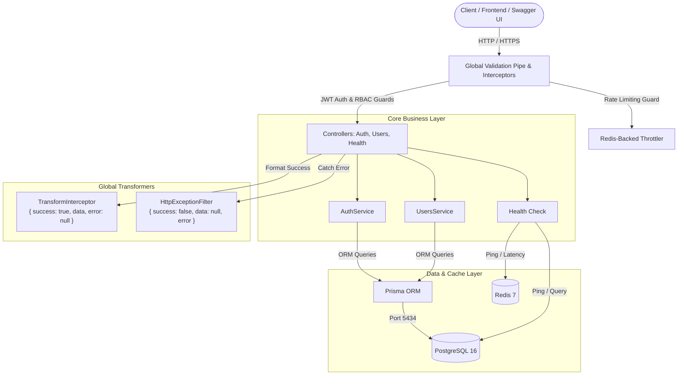

# 🏢 Enterprise REST API — Modular NestJS Backend Platform

[](https://github.com/nan-kyaw-thae-su/enterprise-rest-api/actions)
[](https://nestjs.com)
[](https://www.typescriptlang.org)
[](https://www.prisma.io)
[](https://www.postgresql.org)
[](https://redis.io)
[](https://www.docker.com)
[](http://localhost:3000/api/docs)

> A production-grade, enterprise-ready backend RESTful API architected around **Domain-Driven Design (DDD)** and **Clean Modular Architecture**, featuring **JWT Authentication**, **Cryptographic Refresh Token Rotation**, **Role-Based Access Control (RBAC)**, **Redis Rate Limiting**, and **Comprehensive E2E Integration Testing**.

---

## 🏗️ Architecture Overview



---

## ✨ Key Enterprise Capabilities

1. **Security & Authentication Flow:**
   - **Dual-Token Architecture:** Short-lived access tokens (15m) paired with long-lived refresh tokens (7d).
   - **Cryptographic Refresh Token Rotation (RFC 7519):** Every token refresh invalidates the previously used refresh token and issues a unique JWT with `jti` (JWT ID). Automatic detection of token reuse invalidates all active sessions for the compromised user account.
   - **One-Way Password Hashing:** Securely salted password hashes utilizing `bcrypt`.
2. **Role-Based Access Control (RBAC):**
   - Three hierarchical roles: `ADMIN`, `MEMBER`, and `VIEWER`.
   - Granular route protection using custom `@Roles(...)` metadata decorators and NestJS `RolesGuard`.
3. **Resilience & Rate Limiting:**
   - Distributed rate limiting using `@nestjs/throttler` backed by Redis to prevent brute-force attacks and API abuse.
4. **Standardized API Response Envelope:**
   - Consistent JSON envelope on all endpoints:
   ```json
   {
     "success": true,
     "data": { ... },
     "error": null,
     "timestamp": "2026-10-18T13:00:00.000Z"
   }
   ```
5. **OpenAPI / Swagger 3.0 Documentation:**
   - Interactive UI at `/api/docs` with Bearer auth injection and typed DTO schemas.
6. **Deep Observability & Health Checks:**
   - `/api/v1/health` validates active database query execution and Redis latency metrics.

---

## 📡 API Endpoints Matrix

| Module | Method | Path | Access | Description |
| :--- | :---: | :--- | :---: | :--- |
| **System** | `GET` | `/api/v1/health` | Public | System uptime, RAM metrics, DB & Redis latency |
| **Auth** | `POST` | `/api/v1/auth/register` | Public | Register user account with default `MEMBER` role |
| **Auth** | `POST` | `/api/v1/auth/login` | Public | Authenticate user; returns tokens and profile |
| **Auth** | `POST` | `/api/v1/auth/refresh` | Public | Exchange and rotate refresh token for new pair |
| **Auth** | `POST` | `/api/v1/auth/logout` | Authenticated | Revoke session and refresh token |
| **Auth** | `GET` | `/api/v1/auth/me` | Authenticated | Retrieve current user profile and role |
| **Users** | `GET` | `/api/v1/users` | `ADMIN` | List all users and profiles |
| **Users** | `GET` | `/api/v1/users/:id` | `ADMIN, MEMBER, VIEWER` | Get user details by ID |
| **Users** | `PATCH` | `/api/v1/users/:id/role` | `ADMIN` | Update a user's role (Admin, Member, Viewer) |
| **Users** | `PATCH` | `/api/v1/users/:id/status` | `ADMIN` | Activate or suspend user account |

---

## 🛠️ Quickstart & Local Setup

### Prerequisites
- [Node.js](https://nodejs.org) >= 20.x
- [Docker & Docker Compose](https://www.docker.com)

### 1. Clone & Install Dependencies
```bash
git clone https://github.com/nan-kyaw-thae-su/enterprise-rest-api.git
cd enterprise-rest-api
npm install
```

### 2. Configure Environment Variables
Copy `.env.example` into `.env`:
```bash
cp .env.example .env
```

### 3. Start Database & Redis via Docker
```bash
docker compose up -d
```
*PostgreSQL is exposed on port `5434` and Redis on port `6379`.*

### 4. Run Migrations & Seed Demo Accounts
```bash
npx prisma migrate dev
npx prisma db seed
```

**Seeded Credentials:**
| Role | Email | Password |
| :--- | :--- | :--- |
| **ADMIN** | `admin@enterprise.dev` | `AdminPass123!` |
| **MEMBER** | `member@enterprise.dev` | `MemberPass123!` |
| **VIEWER** | `viewer@enterprise.dev` | `ViewerPass123!` |

### 5. Launch Development Server
```bash
npm run start:dev
```
- API Base URL: `http://localhost:3000/api/v1`
- Swagger Documentation: `http://localhost:3000/api/docs`

---

## 🧪 Testing

```bash
# Run unit tests
npm run test

# Run End-to-End (E2E) integration test suites
npm run test:e2e

# Run linter
npm run lint

# Check test coverage
npm run test:cov
```

---

## 🚀 Deployment

The project is structured for easy deployment to containerized platforms:
- **Database:** Serverless PostgreSQL via [Neon.tech](https://neon.tech)
- **Redis:** [Upstash](https://upstash.com) Serverless Redis
- **App Service:** [Render](https://render.com) Web Service with Dockerfile or Node.js runtime

---

## 📄 License
MIT
